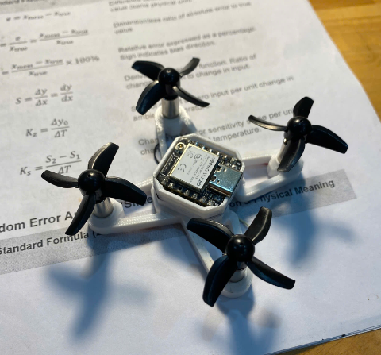

# Drone mini XIAO ESP32-S3

Đồ án môn học của nhóm: drone mini 4 cánh dùng XIAO ESP32-S3, điều khiển bằng app ESP-Drone trên điện thoại qua Wi-Fi.



Drone đã bay thử được, giữ cân bằng khá ổn. Hiện tại con XIAO ESP32-S3 bị hỏng lúc tháo bo ra khỏi khung, nhóm đang chờ mạch mới về để lắp lại.

## Thư mục

- `firmware/` – code ESP-Drone, đã chỉnh chân cho bo của nhóm
- `hardware/` – file KiCad, Gerber, BOM, sơ đồ nguyên lý
- `frame/` – khung 3D
- `docs/` – sơ đồ khối, lưu đồ, ảnh app và ảnh drone

## Phần cứng

- XIAO ESP32-S3
- Cảm biến MPU-6050
- 4 motor coreless 6x15mm, mỗi motor 1 MOSFET KSI2300DS
- Pin LiPo 1S 3.7V
- PCB 4 lớp 17.75 x 21mm, làm lại từ thiết kế ESP-FLY rồi đặt xưởng gia công
- Khung tự vẽ trên SolidWorks rồi đem in 3D

Chân đang dùng:

| Chức năng | GPIO |
|---|---|
| Motor M1 (trước phải) | 7 |
| Motor M2 (sau phải) | 4 |
| Motor M3 (sau trái) | 3 |
| Motor M4 (trước trái) | 1 |
| SDA / SCL (MPU-6050) | 5 / 6 |
| INT (MPU-6050) | 8 |
| Đo điện áp pin | 2 |
| LED đỏ / LED xanh lá | 43 / 9 |

## Build và nạp code

Nhóm dùng ESP-IDF 5.0.

```
cd firmware
idf.py build
idf.py -p COMx flash monitor
```

Không chạy `idf.py set-target` vì nó sẽ tạo lại `sdkconfig` và mất cấu hình chân.

So với code gốc, nhóm sửa `sdkconfig` (chân motor, I2C, LED) và `motors.h` (cho motor quay thử lâu hơn lúc khởi động để dễ quan sát).

## Cách điều khiển

1. Cắm pin, đợi 4 motor quay thử lần lượt và LED xanh chớp 5 lần.
2. Điện thoại vào Wi-Fi `ESP-DRONE_xxxx`, mật khẩu `12345678`.
3. Mở app ESP-Drone, bấm kết nối, kéo ga về 0 trước rồi mới đẩy ga lên.

## Thành viên

- Ngô Hải Nam (nhóm trưởng) – thiết kế PCB, hàn mạch
- Phạm Chu Quốc – thiết kế và in khung 3D, cài app
- Nguyễn Hữu Phong – báo cáo, lưu đồ, tìm hiểu PID

GVHD: TS. Đỗ Trần Thắng – Trường Đại học Công nghệ, ĐHQGHN

## Tham khảo

- Firmware: [espressif/esp-drone](https://github.com/espressif/esp-drone)
- Mạch: [ESP-FLY](https://github.com/Seeed-Projects/Co-Create_ESP-FLY) của Max Imagination

Giấy phép GPL-3.0 theo dự án gốc.
